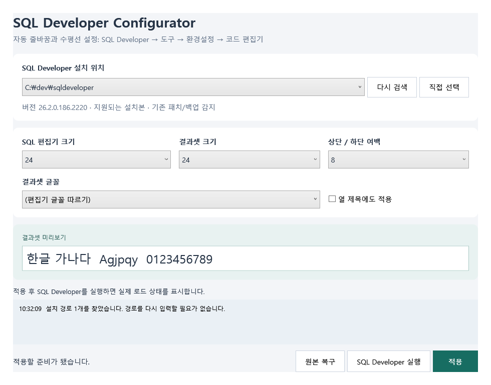
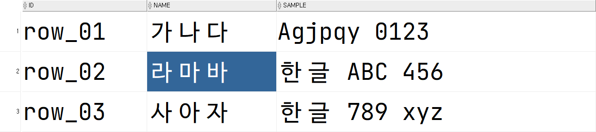
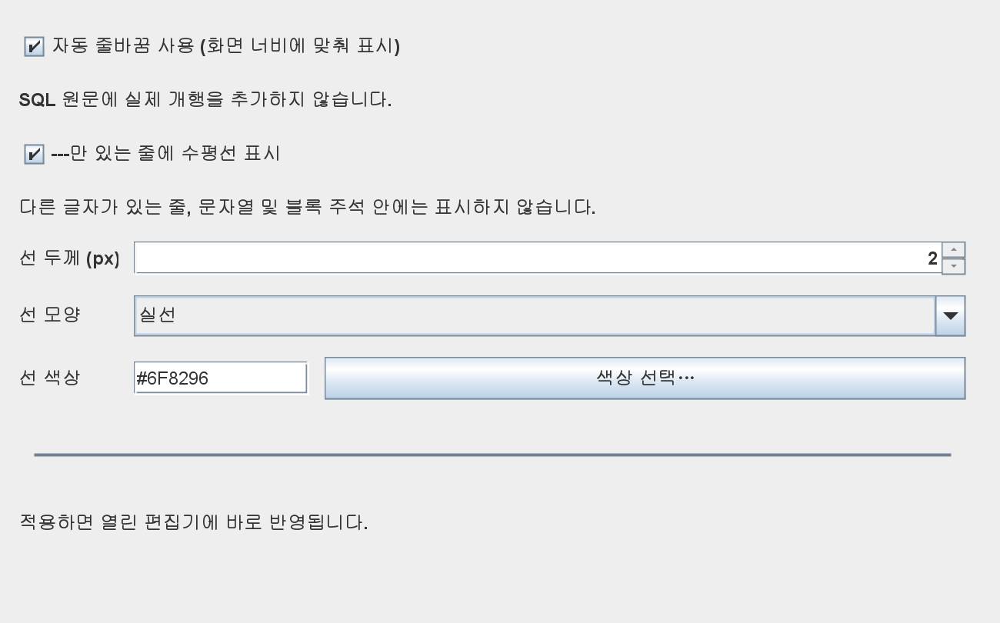
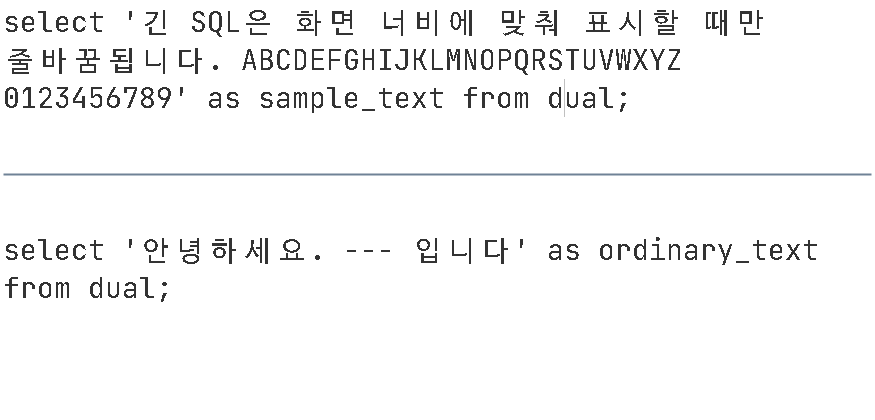
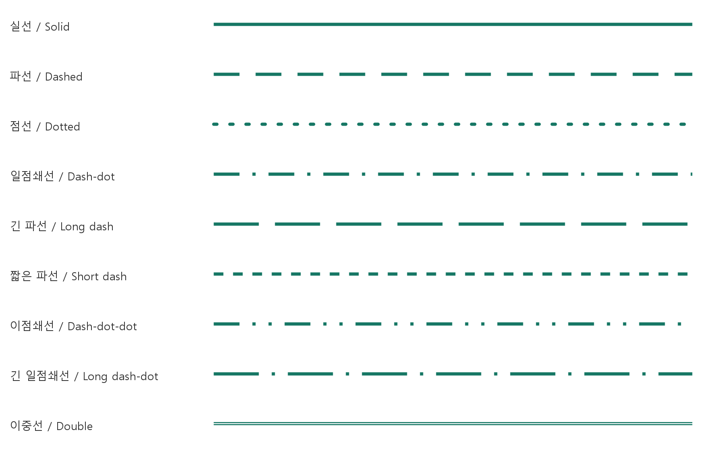

<p align="center"></p>

# SQL Developer Configurator

Oracle SQL Developer 환경 설정 도구

- SQL 편집기·결과셋 글꼴을 **최대 50pt**로 설정
- 결과셋 글자가 위아래로 잘리지 않도록 **행 높이와 셀 여백 조절**
- 편집기 너비에 맞춘 **자동 줄바꿈**
- `---` 단독 줄을 **수평 구분선**으로 표시하고 두께·색상·모양 설정


## 1. 처음 적용하기

1. 위 링크에서 **SQLDeveloperConfigurator.exe**를 내려받습니다.
2. SQL 작업을 저장하고 **SQL Developer를 종료**합니다.
3. Configurator를 실행합니다. 설치 위치는 자동 검색됩니다.
4. 적용할 설치본을 선택하고 글꼴 크기와 여백을 정합니다.
5. **적용**을 누른 뒤 **SQL Developer 실행**을 누릅니다.

설치본이 검색되지 않으면 **직접 선택**에서 `sqldeveloper.exe`를 선택하세요. 선택한 위치는 다음 실행에도 기억됩니다.

<a href="docs/images/configurator.png"></a>

## 2. 글꼴 크기와 결과셋 여백

Configurator에서 다음 항목을 설정하고 **적용**합니다. 변경할 때는 SQL Developer를 먼저 종료하세요.

| 항목 | 사용 방법 |
| --- | --- |
| SQL 편집기 크기 | **7~50pt** 중 선택 |
| 결과셋 크기 | **6~50pt** 중 선택 |
| 결과셋 글꼴 | 설치된 글꼴을 선택하거나 **편집기 글꼴 따르기** 사용 |
| 상단 / 하단 여백 | **-20~30px**. 선택한 값이 위·아래에 각각 적용됨 |
| 열 제목에도 적용 | 결과표의 열 제목에도 글꼴 설정 적용 |

여백을 늘리면 행이 높아지고, 줄이면 더 많은 행을 볼 수 있습니다. 음수 값으로 너무 좁히면 글자가 잘릴 수 있습니다. 긴 값이 가로로 잘리면 열 제목 사이의 경계를 끌어 열 너비를 넓히세요.

**50pt · 위아래 여백 8px 예시**

<a href="docs/images/results-50pt.png"></a>

편집기 글꼴은 SQL Developer의 **도구 → 환경설정 → 코드 편집기 → 글꼴**에서도 바꿀 수 있습니다.

## 3. 자동 줄바꿈

1. SQL Developer에서 **도구 → 환경설정**을 엽니다.
2. **코드 편집기 → 자동 줄바꿈 · 수평선**을 선택합니다.
3. **자동 줄바꿈 사용**을 체크하고 **확인**을 누릅니다.

<a href="docs/images/preferences.png"></a>

긴 SQL이 편집기 너비에 맞춰 이어서 표시됩니다. 저장되는 SQL에 개행을 추가하지 않습니다. 체크를 해제하면 가로 스크롤 방식으로 돌아갑니다.

<a href="docs/images/editor-wrap.png"></a>

## 4. 수평 구분선

같은 환경설정에서 **`---`만 있는 줄에 수평선 표시**를 체크합니다.

| 설정 | 선택 범위 |
| --- | --- |
| 선 두께 | **0.5~8px** |
| 선 색상 | **색상 선택** 버튼 또는 `#RRGGBB` 입력 |
| 선 모양 | **실선 · 파선 · 점선 · 일점쇄선** |

<a href="docs/images/rule-styles.png"></a>

SQL 편집기에서 한 줄에 `---`만 입력하면 가로 영역을 잇는 선으로 보입니다. 하이픈 문자는 화면에서 숨겨지며, 저장·복사할 때는 원래 `---`가 유지됩니다.

```sql
select 1 from dual;

---

select 2 from dual;
```

- 앞뒤에 공백이나 탭이 있어도 표시합니다.
- `안녕하세요. --- 입니다`, `--- 설명`, `----`처럼 다른 내용이 있으면 표시하지 않습니다.
- 문자열이나 블록 주석 안에서는 표시하지 않습니다.

**선을 지우려면** 해당 줄에서 하이픈 하나를 지워 `--`로 만들거나 줄을 삭제하세요. 기능을 끄면 원래 하이픈 문자가 다시 보입니다.

자동 줄바꿈과 수평선 설정은 **확인 / 적용**을 누르면 열린 편집기에 반영됩니다. **취소**하면 변경 사항을 저장하지 않습니다.

## 5. 다른 PC · 업데이트 · 원본 복구

| 작업 | 순서 |
| --- | --- |
| 다른 PC에서 사용 | 실행 파일 하나를 복사 → 실행 → 설치본 선택 → **적용** |
| 새 버전으로 업데이트 | SQL Developer 종료 → 새 Configurator 실행 → **적용** |
| 원본으로 되돌리기 | SQL Developer 종료 → Configurator 실행 → **원본 복구** |

적용 전 원본과 설정을 자동 백업합니다. 다른 PC에서도 같은 글꼴을 쓰려면 해당 글꼴을 설치하세요.

## 자주 묻는 질문

| 증상 | 해결 방법 |
| --- | --- |
| 환경설정 메뉴가 보이지 않아요 | Configurator에서 **적용**한 뒤 SQL Developer를 다시 실행하세요. **코드 편집기 바로 아래**에 있습니다. |
| 결과셋 글자가 위아래로 잘려요 | Configurator의 **상단 / 하단 여백**을 늘리고 다시 적용하세요. |
| 설치 위치를 못 찾아요 | **직접 선택**에서 설치 폴더의 `sqldeveloper.exe`를 선택하세요. |
| 적용 또는 복구를 못 해요 | SQL Developer가 종료되어 있는지, 지원 버전인지 확인하세요. 쓰기 권한 오류이면 Configurator를 관리자 권한으로 실행하세요. |
| 수평선이 표시되지 않아요 | 수평선 옵션을 켰는지, 해당 줄에 공백을 제외하고 `---`만 있는지 확인하세요. |

## 개발 · 라이선스

[소스 빌드 및 테스트](docs/DEVELOPMENT.md) · [배포 방법](docs/PUBLISHING.md) · [이미지 생성](docs/SCREENSHOTS.md)

[MIT License](LICENSE). 외부 소프트웨어는 [THIRD_PARTY_NOTICES.md](THIRD_PARTY_NOTICES.md)를 참고하세요.
